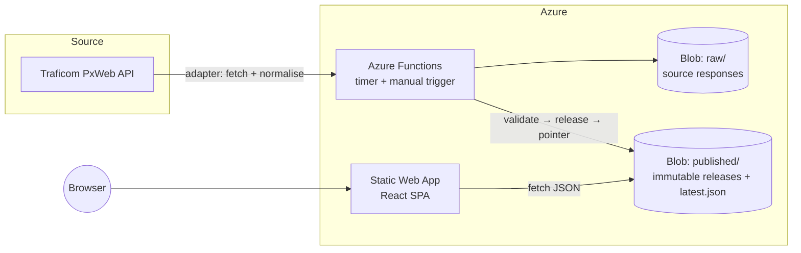

# Ensirekisteröinnit: Finnish car registrations explorer

A bilingual (Finnish and English) web app for exploring first registrations of passenger cars in
Finland. It shows how fuel types are shifting towards electric and how individual makes and models
develop month by month.

The data comes from [Traficom](https://trafi2.stat.fi/PXWeb/pxweb/fi/TraFi/TraFi__Ensirekisteroinnit/)
(CC BY 4.0). A scheduled job fetches it, validates it and publishes it as static, versioned JSON, so
the site stays fast and keeps working when the upstream service is slow or down.

## Features

- Search by name: type a make or model and open its page. The suggestions list the most
  registered models, and `/` focuses the search from anywhere.
- The overview shows the share of each fuel type over time (stacked area, switch between share and
  count, period presets), yearly totals, the rolling 12-month electric share and year-over-year key
  figures. Its headline sentence is computed from the data.
- The makes and models page lists 700+ makes and model series, searchable and sortable. Each model
  has a page with monthly or yearly registrations by fuel type.
- The table page shows all passenger cars by month or year, sortable and searchable, with CSV export.
- Fuel types differ in shape as well as colour. Charts can be stepped through with the keyboard and
  are read out by screen readers. There are light and dark themes.
- The UI is in Finnish and English. On desktop it has a navy side rail, on phones a tab bar.

## Architecture



Design decisions:

- Everything that knows about the data provider lives in a source adapter. Traficom has announced a
  database migration, so replacing the source means writing one new adapter and changing nothing
  else.
- The web app depends only on a small, versioned JSON format (`manifest.json`, `entities.json`,
  `entities/<id>.json`), never on the upstream API.
- Each ingest writes a complete release folder and updates `latest.json` last. Readers see either
  the old release or the new one, never a partial one.
- A run first compares the source's version stamp and exits if nothing changed. If validation fails,
  the run aborts and the previous release keeps being served.
- There is no database. A release is a few MB, and static JSON on blob storage is simpler, cheaper
  and faster than a query layer.

## Tech stack

| Area           | Choice                                                                    |
| -------------- | ------------------------------------------------------------------------- |
| Language       | TypeScript everywhere (shared types via `@regs/core`)                     |
| Frontend       | React, React Router, ECharts, TanStack Table, hand-written CSS            |
| Ingest         | Node.js, Azure Functions v4 (Flex Consumption), Azure Blob Storage        |
| Infrastructure | Bicep (storage, Functions, Application Insights, Static Web App)          |
| Quality        | Vitest, ESLint, Prettier, strict `tsc`, GitHub Actions (CI + OIDC deploy) |

## Repository layout

```
packages/core      Domain model, fuel taxonomy and pure series helpers (shared)
packages/ingest    Source adapters, validation, release builder, storage backends, CLI
apps/functions     Azure Functions host (timer + manual HTTP trigger), bundling script
apps/web           React single-page app
infra              Bicep templates
```

## Getting started

Requires Node.js 20+.

```bash
npm ci
npm run ingest      # fetch real data from Traficom into .data/published (takes ~10 s)
npm run dev         # start the web app on http://localhost:5173 using that data
```

Other commands:

```bash
npm test            # unit tests
npm run typecheck
npm run lint
npm run build       # production build of all packages
```

During development the Vite server serves `.data/published` at `/data`. In production the app reads
from `VITE_DATA_BASE_URL`, which points at the public `published` blob container.

## Deployment

The infrastructure is defined in [`infra/`](infra) (Bicep) and deployed from GitHub Actions with
OpenID Connect, so no credentials are stored. The templates have not been run against a live
subscription yet, so review the first deployment with `what-if`.

1. Provision the resources. Sweden Central is the closest region to Finland.

   ```bash
   az group create -n rg-regs-prod -l swedencentral
   az deployment group what-if -g rg-regs-prod -f infra/main.bicep -p infra/main.prod.bicepparam
   az deployment group create  -g rg-regs-prod -f infra/main.bicep -p infra/main.prod.bicepparam
   ```

2. Connect GitHub to Azure. Create an app registration with a federated credential for the
   repository's `production` environment and give it `Contributor` on the resource group. Then set
   these repository variables: `AZURE_CLIENT_ID`, `AZURE_TENANT_ID`, `AZURE_SUBSCRIPTION_ID`,
   `RESOURCE_GROUP`, `FUNCTION_APP_NAME`, `STATIC_WEB_APP_NAME` (the last two come from the
   deployment outputs) and `DATA_BASE_URL` (the `dataBaseUrl` output).
3. Push to `main` or run the _Deploy_ workflow.
4. Load the first data instead of waiting for the schedule:
   `POST https://<functionAppName>.azurewebsites.net/api/ingest?force=true` with the function key in
   the `x-functions-key` header.

The schedule is the `INGEST_SCHEDULE` app setting (NCRONTAB, UTC, default `0 0 8,12 * * *`), and
changing it needs no redeployment. To roll back, point `published/latest.json` at an earlier release
folder. The `published` container is public on purpose: the data is open, and CORS limits browser
access to the site. The `raw` container is private. Releases are never expired by age, so the site
keeps working if the source stops updating.

## Data notes and limitations

- Monthly data starts in January 2014. The source has no daily figures.
- The counts are first registrations, not the number of cars in use.
- The source has a separate fuel category only for plug-in hybrids. Other hybrids are included in
  its other categories.
- The current year is incomplete, and the UI marks it.
- The source excludes Åland.

## Roadmap

- Municipality-level views (the source table already has a municipality dimension).
- Vehicle stock ("cars in use") by make and model, from Traficom's open vehicle register and
  quarterly statistics files.
- Model comparison and shareable chart links.

## Licence

Code: [MIT](LICENSE). Data: © Traficom, licensed under
[CC BY 4.0](https://creativecommons.org/licenses/by/4.0/).
