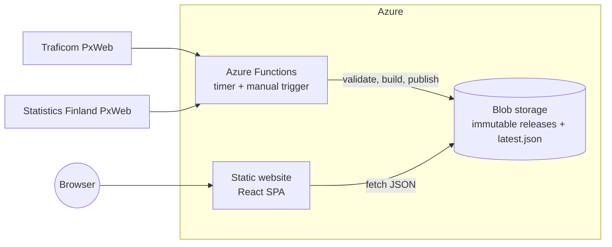

# Ensirekisteröinnit

A bilingual (Finnish and English) web app for exploring first registrations of passenger cars in
Finland: how fuel types shift towards electric, and how makes, models and corporate groups develop
month by month. I built it alone, from data pipeline to cloud infrastructure.

A scheduled Azure Function fetches open data from [Traficom](https://trafi2.stat.fi/PXWeb/pxweb/fi/TraFi/TraFi__Ensirekisteroinnit/)
and [Statistics Finland](https://stat.fi/en), validates it and publishes versioned JSON. A React
single-page app reads those files. There is no database and no API server.

## What it does

- **Overview:** a ring of the latest month's fuel mix with the electric share in the middle, then
  share-over-time charts, yearly totals, the electric share of all cars in traffic and fuel prices
  on the same time axis.
- **Makes and models:** more than 700 makes and model series, searchable and sortable, each with its
  own page.
- **Review:** ranks makes, models or corporate groups for any period, for new or used-imported
  cars, with filters, period comparison and CSV export.
- **Compare:** two to four makes, models or groups side by side, with the choices kept in the URL
  so a comparison can be shared.
- **Areas:** a map and table of registrations by region and municipality (data from 2021).
- **Accessibility:** charts work with the keyboard and screen readers, fuel types differ in shape as
  well as colour, and there are light and dark themes.

## How it works



- **Source adapters:** all provider-specific code lives in one adapter per source. Traficom has
  announced a database migration, so a new source means one new adapter and no other changes.
- **Immutable releases:** each run writes a complete release folder and moves `latest.json` last,
  so readers see the old release or the new one, never a half-written one. If validation fails, the
  previous release keeps serving.
- **Versioned contract:** the web app depends only on a small JSON format defined in
  `packages/core`, never on the upstream API.
- **Resumable ingest:** the regional dataset has 294 areas and a long first run. Progress is cached
  per area, and later runs fetch only the latest months.
- **Cheap to run:** static JSON on blob storage replaces a query layer. The timer exits after one
  metadata call when the source has not changed.

## Tech stack

| Area           | Choice                                                                    |
| -------------- | ------------------------------------------------------------------------- |
| Language       | TypeScript (strict), shared types in `@regs/core`                         |
| Frontend       | React, React Router, ECharts, TanStack Table, hand-written CSS            |
| Ingest         | Node.js, Azure Functions v4 (Flex Consumption), Azure Blob Storage        |
| Infrastructure | Bicep (storage, Functions, Application Insights, static website)          |
| Quality        | Vitest, ESLint, Prettier, strict `tsc`, GitHub Actions (CI + OIDC deploy) |

## Repository layout

```
packages/core      Domain model, fuel taxonomy, pure series helpers (shared)
packages/ingest    Source adapters, validation, release builder, storage backends, CLI
apps/functions     Azure Functions host (timer + manual HTTP trigger)
apps/web           React single-page app
infra              Bicep templates
```

## Run it locally

Requires Node.js 20+.

```bash
npm ci
npm run ingest      # fetch real data into .data/published (about 10 s)
npm run dev         # web app on http://localhost:5173
```

`npm test`, `npm run typecheck`, `npm run lint` and `npm run build` run the quality checks. Other
datasets load with `npm run ingest -- --dataset used|prices|stock|regional`.

## Deployment

The infrastructure is in [`infra/`](infra) (Bicep) and ships from GitHub Actions with OpenID
Connect, so no credentials are stored. The frontend is a static website on a storage account rather
than Azure Static Web Apps, because that service is available in few regions and some subscriptions
restrict regions by policy. The templates have only been checked with `what-if`, so review the first
deployment.

1. Provision the resources (Sweden Central is closest to Finland):

   ```bash
   az group create -n rg-regs-prod -l swedencentral
   az deployment group what-if -g rg-regs-prod -f infra/main.bicep -p infra/main.prod.bicepparam
   az deployment group create  -g rg-regs-prod -f infra/main.bicep -p infra/main.prod.bicepparam
   az deployment group show -g rg-regs-prod -n main --query properties.outputs
   ```

2. Create the deployment identity: an app registration with a federated credential for the
   repository's `production` environment (the `subject` must match exactly), then grant it
   `Contributor` on the resource group and `Storage Blob Data Contributor` on the web storage account.

   ```bash
   az ad app create --display-name ensirekisteroinnit-deploy --query appId -o tsv
   az ad sp create --id <appId>
   az ad app federated-credential create --id <appId> --parameters '{"name":"github-production","issuer":"https://token.actions.githubusercontent.com","subject":"repo:<owner>/<repo>:environment:production","audiences":["api://AzureADTokenExchange"]}'
   az role assignment create --assignee <appId> --role Contributor --scope /subscriptions/<subscriptionId>/resourceGroups/rg-regs-prod
   az role assignment create --assignee <appId> --role "Storage Blob Data Contributor" --scope $(az storage account show -g rg-regs-prod -n <webStorageAccountName> --query id -o tsv)
   ```

3. Enable static website hosting once, with your own account (the deployment identity cannot change
   service settings):

   ```bash
   az role assignment create --assignee-object-id <your object id> --assignee-principal-type User --role "Storage Blob Data Owner" --scope <web storage account id>
   az storage blob service-properties update --account-name <webStorageAccountName> --auth-mode login --static-website --index-document index.html --404-document index.html
   ```

4. Set the repository variables `AZURE_CLIENT_ID`, `AZURE_TENANT_ID`, `AZURE_SUBSCRIPTION_ID`,
   `FUNCTION_APP_NAME`, `WEB_STORAGE_ACCOUNT` and `DATA_BASE_URL` (the last three are deployment
   outputs), then push to `main` or run the _Deploy_ workflow.
5. Load the first data without waiting for the schedule:
   `POST https://<functionAppName>.azurewebsites.net/api/ingest?force=true` with the function key in
   the `x-functions-key` header. This loads the national data. The timer adds used imports, fuel
   prices and the car stock right after, and the regional data on its own timer. The first regional
   run can exceed the function's 30 minute limit, so seed it from a workstation with
   `npm run ingest -- --dataset regional --azure`; interrupted runs resume where they stopped.

**Operations.** `INGEST_SCHEDULE` (NCRONTAB, UTC, default `0 0 8,12 * * *`) changes the schedule
without a redeploy. To roll back, point `published/latest.json` at an earlier release folder.
Releases never expire by age, so the site keeps working if the source stops updating. The `published`
container is public on purpose (open data, CORS limited to the site); `raw` is private.

**Optional settings.**

- `NOTIFY_EMAIL_TO` (or `-p notifyEmail=...` at deploy time) sends a short English email on each
  published release through Azure Communication Services, using the function's managed identity. A
  failed send never fails the ingest.
- The repository variables `SITE_OPERATOR`, `SITE_CONTACT_URL`, `SITE_HOSTING` and `SITE_REPO_URL`
  fill the About page at runtime through `site.config.json`, so a fork needs no code changes. The
  texts are general and are not legal advice.
- `SITE_URL` turns on `sitemap.xml` (every page in both languages plus each make and model),
  `robots.txt` and canonical links, so nothing in the repository names a specific domain. Submit the
  sitemap in Google Search Console once.
- The storage website cannot set response headers such as `X-Frame-Options`; that needs a CDN or
  Front Door in front.

## Data notes

- Monthly data starts in January 2014; regional data starts in 2021.
- The counts are first registrations. The cars in traffic are a separate dataset, quarterly since
  2008 and by fuel only, with no make or model. The current year is incomplete and the UI marks it.
- The source excludes Åland and has a separate fuel category only for plug-in hybrids.
- Used imports are known by make only. Corporate groups follow today's ownership.
- Fuel prices are nominal monthly averages.

Next on the list is the car stock by make, with the average age, from Traficom's stock tables.

## Licence

Code: [MIT](LICENSE). Data: © Traficom and © Statistics Finland, both licensed under
[CC BY 4.0](https://creativecommons.org/licenses/by/4.0/).
